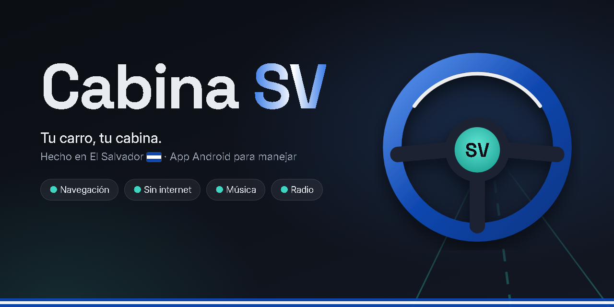
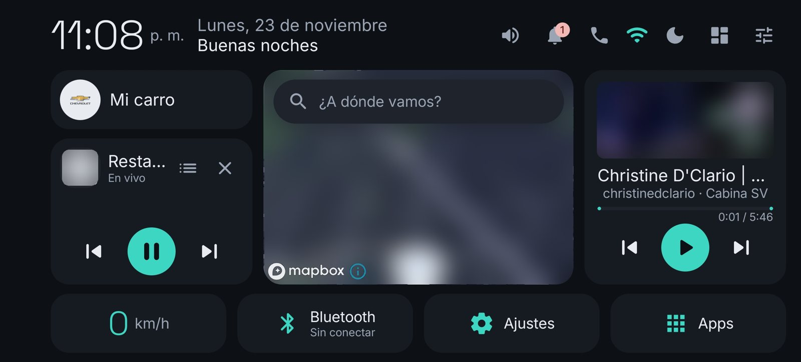
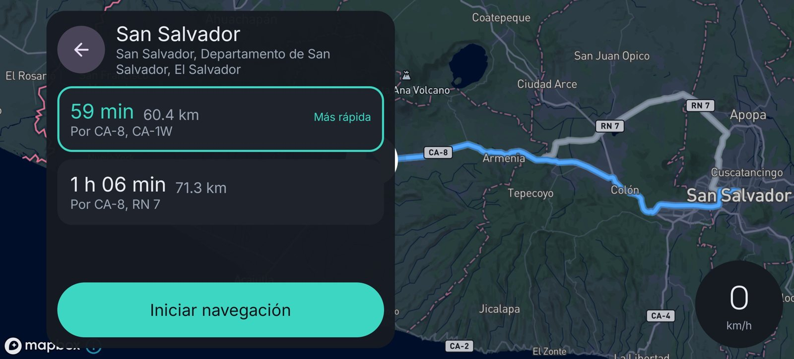
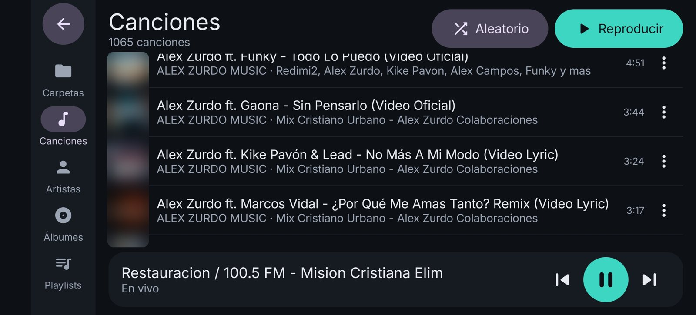
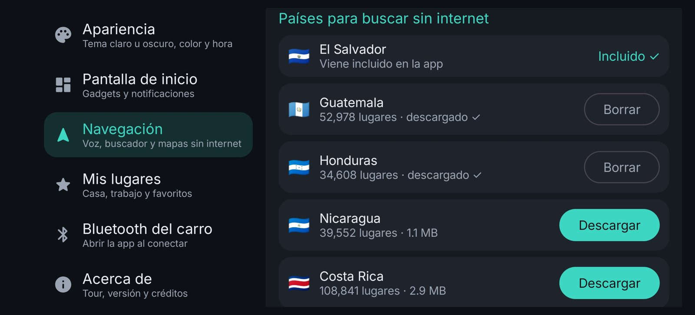
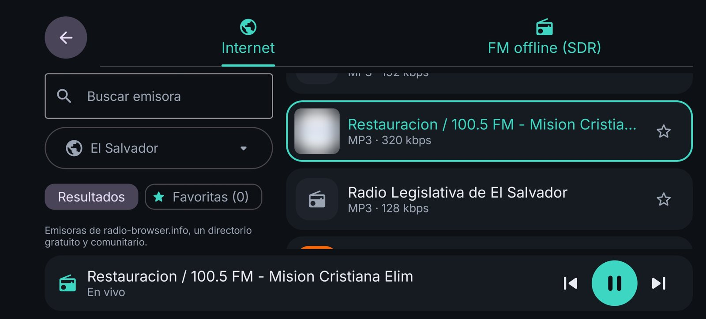
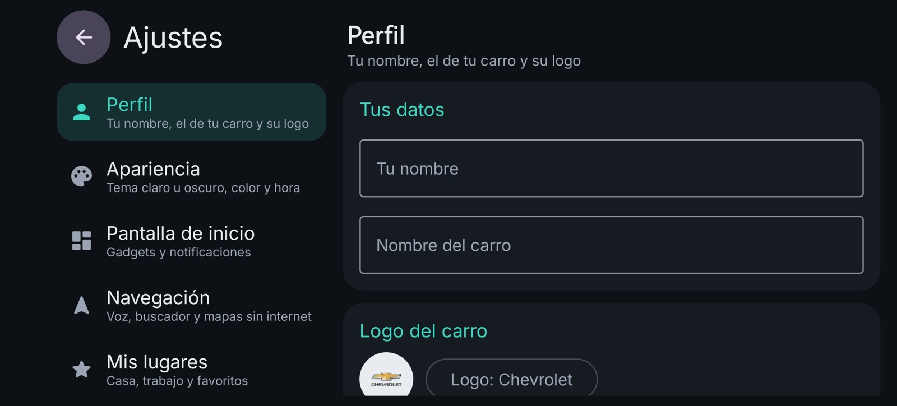

  

  <a href="https://play.google.com/store/apps/details?id=com.modocarro.app"><b>▶ Próximamente en Google Play</b></a>
  &nbsp;·&nbsp;
  <a href="https://patinorafa04-ship-it.github.io/cabina-sv-app/">Página web</a>
  &nbsp;·&nbsp;
  <a href="https://patinorafa04-ship-it.github.io/cabina-sv-mapas/privacidad.html">Privacidad</a>

# Cabina SV

**Tu carro, tu cabina.** Cabina SV convierte tu teléfono Android en el tablero de tu carro: navegación, música, radio, llamadas y notificaciones en una sola pantalla horizontal, con botones grandes y pensada para verse de un vistazo mientras manejas.

Hecha en El Salvador 🇸🇻, con un buscador que funciona **sin internet**: más de 41 mil lugares, colonias y calles del país incluidos, y países de Centroamérica para descargar.

## Capturas

| Inicio | Navegación | Música |
|---|---|---|
|  |  |  |

| Buscar sin internet | Radio | Ajustes |
|---|---|---|
|  |  |  |

## Qué hace

### 🧭 Navegación
- Rutas con **guía por voz** y varias opciones de camino.
- **Límite de velocidad** de la calle junto a tu velocidad (se pone en rojo si te pasas).
- Mapa de **día o de noche** según la hora.
- **Búsqueda sin internet**: El Salvador incluido; Guatemala, Honduras, Nicaragua, Costa Rica y Panamá para descargar.
- **Dictado por voz** del destino, también sin internet.
- **Mis lugares**: mantén presionado el mapa para guardar Casa, Trabajo o favoritos.
- Sin internet, la ruta se puede abrir en Organic Maps.

### 🎵 Música y radio
- Tu música del teléfono por **carpetas**, canciones, artistas, álbumes y **playlists**.
- Recuerda la canción y el **segundo exacto** donde quedaste.
- **Radio por internet** con miles de emisoras y tus favoritas.
- Controla **Spotify, YouTube Music** y otras apps desde el inicio; desliza la carátula para cambiar de canción.

### 📱 Al volante
- **Inicio personalizable**: mueve, oculta e intercambia gadgets.
- **Notificaciones** en un panel que se cierra solo.
- **Llamadas** a tus contactos favoritos con un toque.
- Se **abre sola** al conectar el Bluetooth de tu carro.
- Tema **claro, oscuro o automático** y el color que prefieras.
- **Tour de bienvenida** que explica cada parte.

## Ficha técnica

| | |
|---|---|
| **Versión** | 1.0.0 |
| **Sistema** | Android 8.0 o superior |
| **Orientación** | Horizontal (gira 180° si volteas el teléfono) |
| **Tamaño aproximado** | 55 a 75 MB según el teléfono |
| **Idioma** | Español |
| **Precio** | Gratis, sin anuncios |
| **Cuenta** | No necesita cuenta |
| **Funciona sin internet** | Búsqueda de lugares, dictado por voz, música del teléfono |
| **Necesita internet** | Mapa y rutas, radio, descarga de países |
| **Mapa** | Mapbox (requiere un token gratuito personal; la app explica cómo obtenerlo) |
| **Datos de lugares** | © colaboradores de OpenStreetMap (ODbL) |
| **Desarrollador** | Rafael Aguilar · El Salvador |

### Permisos

| Permiso | Para qué |
|---|---|
| Ubicación | Tu posición, velocidad, límite de la calle y la navegación |
| Música y audio | Reproducir la música guardada en el teléfono |
| Micrófono | Dictar el destino por voz |
| Contactos | Mostrar tus favoritos para llamarlos con un toque |
| Llamadas | Llamar a un favorito con un toque |
| Acceso a notificaciones | Controlar la música de otras apps y ver tus notificaciones en el inicio |
| Bluetooth | Saber si estás conectado al carro y abrir la app al conectar |
| Notificaciones | Controles de la música y el aviso de "tu carro se conectó" |

Todo se queda en tu teléfono. Detalles en la [política de privacidad](https://patinorafa04-ship-it.github.io/cabina-sv-mapas/privacidad.html).

## Preguntas frecuentes

**¿Por qué necesito un token de Mapbox?**
El mapa lo da Mapbox. Cada persona usa su propio token gratuito, así nadie gasta la cuota de otro. Se crea en minutos en [account.mapbox.com](https://account.mapbox.com/access-tokens) y se pega en la app.

**¿Funciona sin datos móviles?**
Sí: puedes buscar lugares, dictar el destino y escuchar tu música. Para ver el mapa y calcular rutas necesitas internet (o abrir la ruta en Organic Maps).

**¿Dónde la descargo?**
Pronto estará en Google Play. Este repositorio no publica instaladores.

---

© 2026 Rafael Aguilar. Todos los derechos reservados. Hecho en El Salvador 🇸🇻
